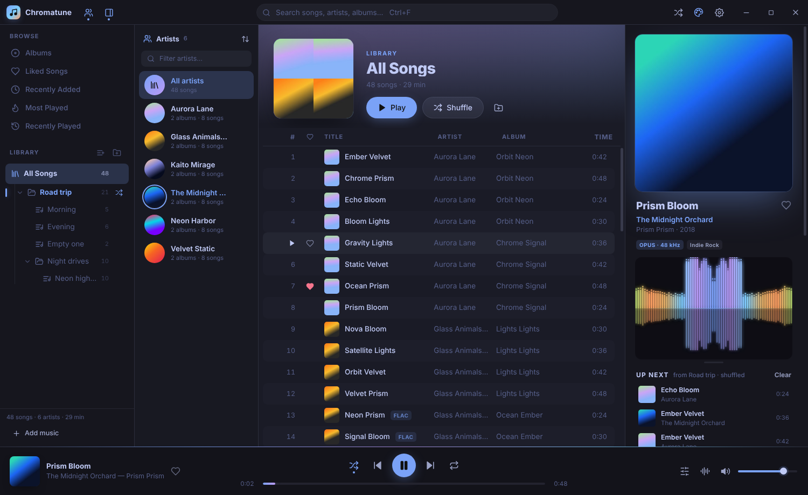
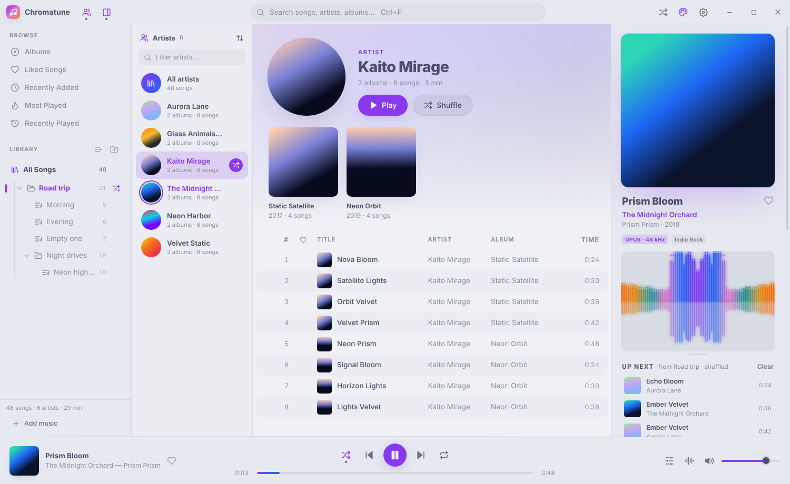
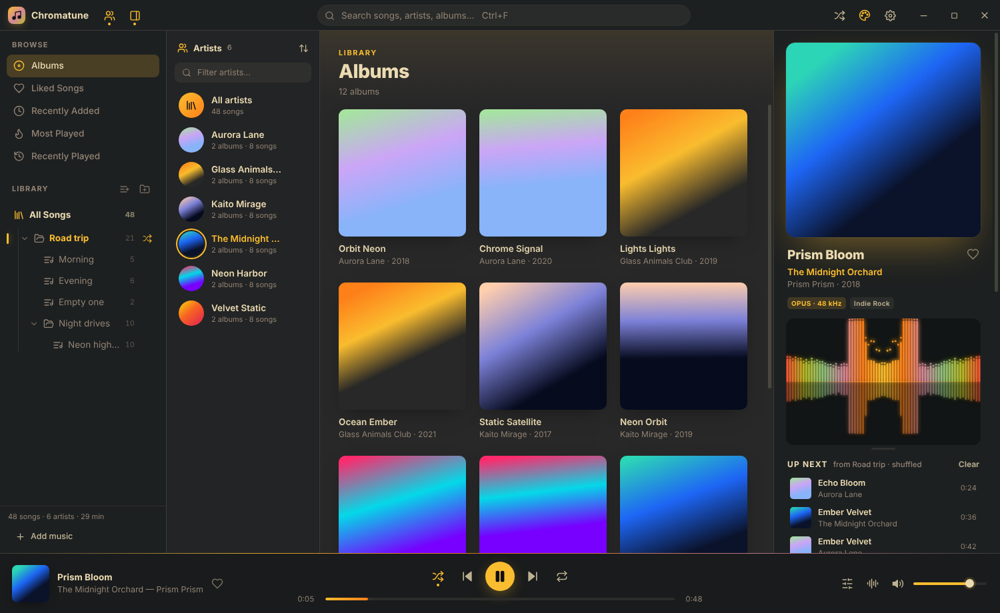
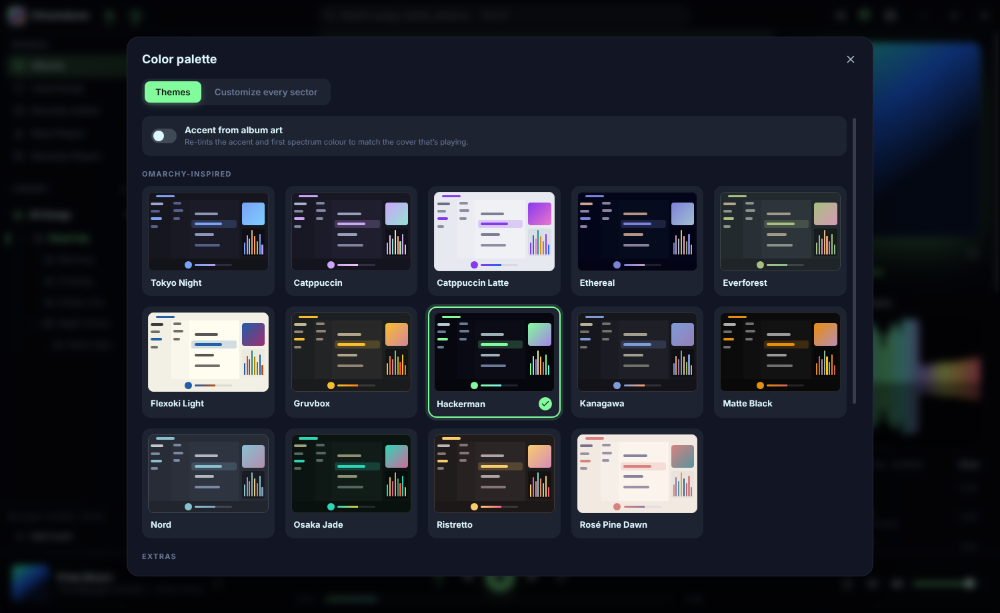
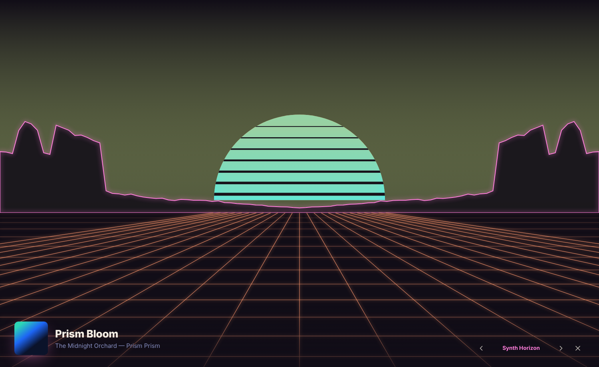

# Chromatune

A themeable, fully offline music player and library manager for **Windows and Linux**, inspired by foobar2000 and omaTUNES.

| Tokyo Night | Catppuccin Latte |
|---|---|
|  |  |
| **Gruvbox — album grid** | **Palette picker** |
|  |  |



## Features

- **Color palettes that recolor everything.** 24 built-in themes: Omarchy-inspired palettes (Tokyo Night, Catppuccin, Catppuccin Latte, Ethereal, Everforest, Flexoki Light, Gruvbox, Hackerman, Kanagawa, Matte Black, Nord, Osaka Jade, Ristretto, Rosé Pine Dawn) plus extras (Dracula, Synthwave '84, Neon Cyberpunk, …).
  - Every area has its own color, and you can change each one in the palette's **Customize** tab: title bar, sidebar, artists panel, song list, list header, now-playing panel, player bar, visualizer backdrop, and menus/dialogs. Text, accents, borders, likes and all six spectrum colors are editable too. Text contrast is corrected automatically.
  - Hover a theme for a live preview, save tweaks as your own theme, or import and export themes as JSON.
  - **Follow Omarchy**: on Omarchy Linux, the app follows your desktop theme and switches when Omarchy does.
  - **Accent from album art**: re-tints the accent to match the cover that's playing.
- **Artists panel.** Every artist in a side panel, with a filter and A–Z / most songs / most played sorting. Click an artist to open their albums and songs. Hover to shuffle that artist.
- **Album art everywhere.** Covers come from embedded tags or from `cover.jpg` / `folder.jpg` in the folder. They appear in the list, album grid, artist pages, now-playing panel, the OS media overlay and the visualizer.
- **8 audio visualizers** drawn only in your palette's colors: Prism Bars, Radial Bloom, Neon Oscilloscope, Starburst, Aurora, Sonic Rings, Synth Horizon and LED Matrix. They run in a resizable panel or fullscreen (`V`).
- **Drag & drop** files or folders from local drives and network drives (UNC paths like `\\NAS\Music`, mapped drives, or SMB/NFS/gvfs mounts on Linux). Drop onto a playlist to import straight into it. `.m3u`/`.m3u8` files become playlists.
- **One big library with nested playlists.** *All Songs* is the root of a tree of folders and playlists, nested as deep as you like.
  - Every node has its own shuffle button. Shuffling a folder plays everything inside it, sub-folders included.
  - The shuffle button on *All Songs* shuffles the entire library at once.
  - Drag songs onto playlists, drag playlists and folders to reorder or nest them, and drag rows inside a playlist to reorder.
- 10-band **equalizer** with presets, a play queue (Play next / Add to queue), likes, play counts, Recently Added / Most Played / Recently Played views, search, sortable columns, and resume where you left off.
- **OS media integration**: MPRIS on Linux (playerctl, Waybar, etc.), Windows media overlay, and media keys.
- Handles very large libraries. The song list is virtualized, and 50,000 songs index in well under a second.
- Formats: MP3, FLAC, OGG/Vorbis, Opus, WAV, M4A/AAC, WebM.

## Run from source

Requires Node.js 20+.

```bash
npm install
npm start                 # on Linux as root: npm run start:root
npm run demo-library      # optional: generate a small tagged test library (needs ffmpeg)
```

## Build installers

```bash
npm run dist:linux   # AppImage, .deb and .tar.gz  -> dist/
npm run dist:win     # NSIS installer + portable .exe -> dist/
```

Windows builds are best produced on Windows, or by the included GitHub Actions workflow (`.github/workflows/build.yml`), which builds both platforms on native runners whenever you push a `v*` tag or run it manually.

## Keyboard shortcuts

| Key | Action | Key | Action |
|---|---|---|---|
| Space | Play / pause | V / F11 | Fullscreen visualizer |
| N / P | Next / previous | B | Next visualizer mode |
| ← / → | Seek ±5 s (Shift ±30 s) | T | Color palette |
| + / − | Volume | [ / ] | Previous / next theme |
| M | Mute | Ctrl+F | Search |
| S | Shuffle | Ctrl+L | Reveal playing song |
| R | Repeat off / all / one | Ctrl+Shift+S | Shuffle entire library |
| L | Like | F2 | Rename playlist / folder |

## Where data lives

Everything is local JSON in the app's data folder (`%APPDATA%\Chromatune` on Windows, `~/.config/Chromatune` on Linux): `library.json`, `playlists.json`, `settings.json`, and a `covers/` cache. Your music files are never modified or moved. Set `CHROMATUNE_DATA=/some/dir` to use a different folder, for example for a portable install.

## Project layout

```
src/main/       Electron main process: window, ct:// protocol (streams audio with range requests), library scanner, Omarchy theme watcher
src/renderer/   UI (vanilla JS modules, no build step)
  js/themes.js       palettes + per-sector token engine
  js/visualizer.js   canvas visualizers
  js/player.js       Web Audio graph (EQ, analyser) + queue/shuffle logic
  js/store.js        state + playlist tree model
```

MIT licensed.
